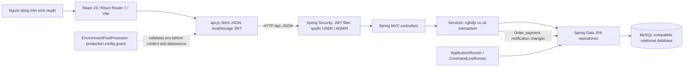
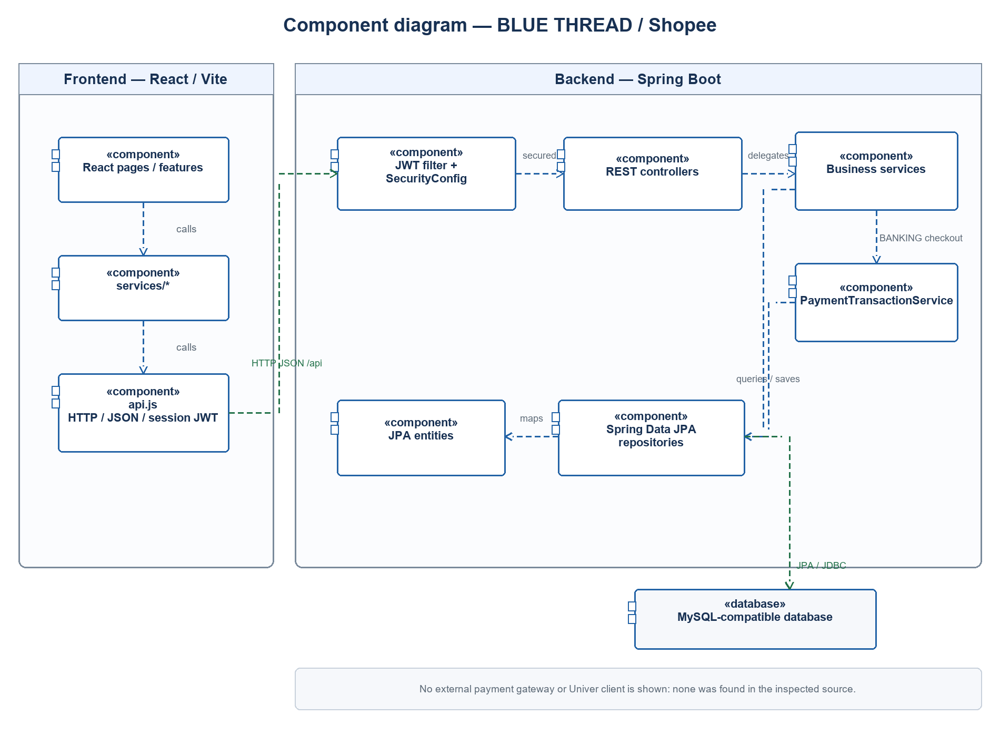
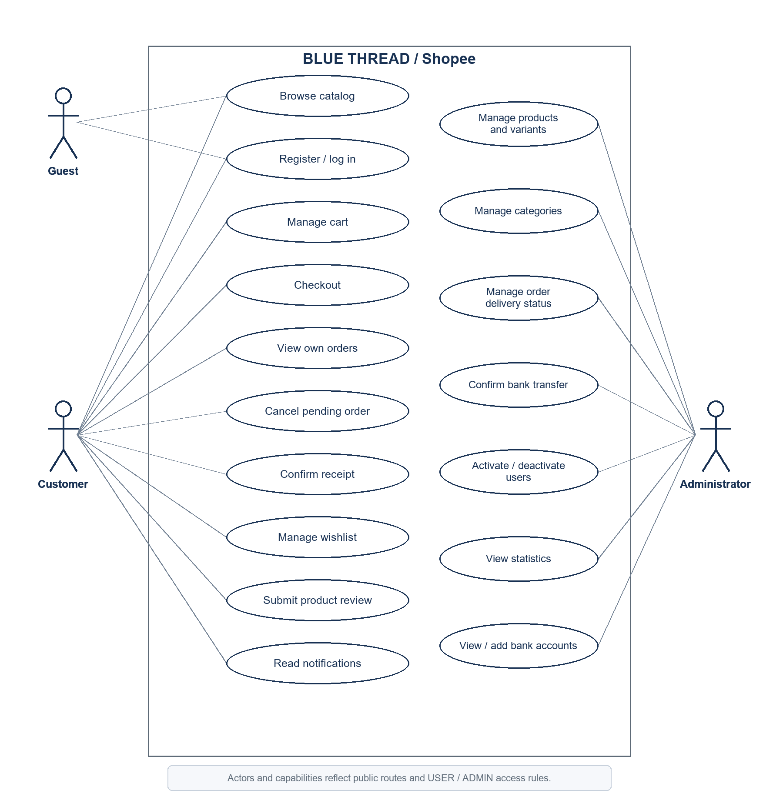

# 01 Kiến trúc phần mềm

## Mục đích và phạm vi

Tài liệu mô tả kiến trúc hiện tại của BLUE THREAD, một cửa hàng thời trang trực tuyến. Repo chứa frontend React trong `frontend/` và backend Spring Boot trong `shopee/`. Các kết luận được đánh dấu là **đã xác minh trong mã**, **được tài liệu dự án xác nhận**, **suy ra từ cách triển khai**, hoặc **chưa xác định**.

## Tóm tắt kiến trúc

Ứng dụng dùng kiến trúc client–server, backend phân lớp. Trình duyệt chạy React/Vite và gọi REST API JSON dưới tiền tố `/api`. Backend Spring MVC tiếp nhận request, Spring Security xử lý JWT và role, controller chuyển tới service nghiệp vụ, service dùng Spring Data JPA repository để đọc/ghi cơ sở dữ liệu quan hệ.

**Đã xác minh trong mã:** backend là Java 21 / Spring Boot 3.5.11 với Spring Web, Data JPA, Security, Validation, MySQL Connector/J và JJWT; dependency được khai báo trong `shopee/pom.xml`. Frontend khai báo React 19, React Router 7 và Vite 6 trong `frontend/package.json`. `frontend/vite.config.js` chạy frontend ở cổng 5173 và proxy `/api` tới `http://localhost:8082`.

**Được tài liệu dự án xác nhận:** `shopee/src/BACKEND_SETUP.md` mô tả MySQL 8 và frontend là project riêng. Tài liệu và `shopee/src/main/resources/application.properties` đều xác nhận Flyway hiện tắt, Hibernate dùng `ddl-auto=update`. Do đó source có các migration nhưng cấu hình mặc định đã commit không tự áp dụng chúng. Schema thực tế của môi trường triển khai chưa thể xác minh từ repo.

## Sơ đồ kiến trúc

Sơ đồ thể hiện quan hệ đã thấy trong source. Việc triển khai cụ thể có thể đặt frontend và backend cùng hoặc khác origin; origin CORS cấu hình được đọc từ `APP_CORS_ALLOWED_ORIGINS`.

### UML Component Diagram

Sơ đồ component thể hiện dependency từ các component giao diện React qua `frontend/src/services/*` và `frontend/src/api.js` tới chuỗi backend Spring Security, controllers, services, repositories và database. Nó thể hiện phụ thuộc `OrderService` → `PaymentTransactionService` cho checkout BANKING. Cơ sở dữ liệu được đặt ngoài package backend. Không vẽ cổng thanh toán hoặc client Univer vì không tìm thấy client tích hợp tương ứng trong source đã rà soát.

**Căn cứ source:** `frontend/src/features/*`, `frontend/src/services/*`, `frontend/src/api.js`; `shopee/src/main/java/com/project_shopping/shopee/config/SecurityConfig.java`; `controller/*`; `service/OrderService.java`; `service/PaymentTransactionService.java`; `repository/*`; `model/*`; `shopee/src/main/resources/application.properties`.

PlantUML source có thể chỉnh sửa: [`component-architecture.puml`](diagrams/component-architecture.puml).

### UML Use Case Diagram

Actor `Guest`, `Customer` và `Administrator` được đối chiếu với quyền public, `USER` và `ADMIN`. Use case là các nhóm mục tiêu người dùng có endpoint tương ứng; sơ đồ không hàm ý thêm quy tắc include/extend. Ranh giới quyền được xác minh trong `SecurityConfig`; các chức năng được đối chiếu với `AuthController`, `ProductController`, `CartController`, `OrderController`, `ReviewController`, `WishlistController`, `NotificationController` và các `Admin*Controller`.

PlantUML source có thể chỉnh sửa: [`use-case.puml`](diagrams/use-case.puml).

Quy ước hình dạng use case, activity partitions/decision nodes, state transitions, sequence lifelines/combined fragments và component dependencies được đối chiếu với [OMG UML 2.5.1](https://www.omg.org/spec/UML/2.5.1/PDF) và tài liệu chính thức của PlantUML cho [Use Case](https://plantuml.com/use-case-diagram), [Activity](https://plantuml.com/en/activity-diagram-beta), [State](https://plantuml.com/en/state-diagram), [Sequence](https://plantuml.com/en/sequence-diagram) và [Component](https://plantuml.com/component-diagram). Các ảnh PNG là biểu đồ đã vẽ theo ký hiệu UML; file `.puml` là nguồn văn bản để hiệu chỉnh.

## Công nghệ và cấu hình xác minh được

| Lớp | Công nghệ / cấu hình | Bằng chứng |
|---|---|---|
| Frontend | JavaScript ES modules, React 19, React DOM, React Router 7, Vite 6, Tailwind CSS 4 qua Vite plugin, Lucide React | `frontend/package.json`, `frontend/vite.config.js` |
| Backend | Java 21, Spring Boot 3.5.11, Spring Web MVC, Spring Data JPA, Spring Security, Jakarta Validation, Lombok | `shopee/pom.xml`, `shopee/src/main/java/com/project_shopping/shopee/` |
| Xác thực | JWT qua JJWT 0.12.6, mật khẩu qua BCryptPasswordEncoder | `shopee/pom.xml`, `config/SecurityConfig.java`, `security/JwtService.java` |
| Database | MySQL JDBC driver; URL local mặc định trỏ `localhost:3306/clotherwebsite`; test profile dùng H2 in-memory | `shopee/src/main/resources/application.properties`, `shopee/src/test/resources/application-test.properties` |
| Schema | JPA entity mapping; có Flyway scripts V1–V9 nhưng Flyway bị tắt trong application properties | `application.properties`, `db/migration/` |
| Build backend | Maven Wrapper; Dockerfile build bằng Maven 3.9.9 / Eclipse Temurin 21, runtime JRE 21 | `shopee/pom.xml`, `shopee/mvnw.cmd`, `shopee/Dockerfile` |
| Build frontend | npm scripts: `dev`, `build`, `preview`, `clean`; lockfile pnpm có trong sibling frontend | `frontend/package.json`, `frontend/pnpm-lock.yaml` |

**Chưa xác định:** cơ sở dữ liệu thực của môi trường đã triển khai, biến môi trường production, pipeline CI/CD, host frontend, và việc Flyway có được bật bằng cấu hình ngoài `application.properties` hay không. Source chỉ chứng minh cấu hình mặc định đã commit.

## Module và trách nhiệm

| Module | Trách nhiệm | Giao tiếp chính |
|---|---|---|
| Giao diện khách hàng | Trang chủ, danh mục, chi tiết và tìm kiếm sản phẩm, giỏ hàng, checkout, tài khoản, yêu thích, đơn hàng, thông báo | React pages gọi `frontend/src/services/*` |
| Giao diện quản trị | Quản lý danh mục, sản phẩm/biến thể, đơn hàng, tài khoản và tổng quan | Frontend admin services gọi `/api/admin/**` |
| REST controllers | Ánh xạ HTTP method/path, lấy principal, bind request DTO, áp dụng `@Valid`, gọi service | Các lớp `controller/*Controller.java` |
| Tài khoản và bảo mật | Đăng ký, đăng nhập, hồ sơ, ký/đọc JWT, nạp tài khoản và role hiện tại từ DB, chặn theo role | `AuthService`, `JwtService`, `JwtAuthenticationFilter`, `SecurityConfig` |
| Danh mục và sản phẩm | Tìm kiếm/ lọc / phân trang sản phẩm; quản lý sản phẩm, biến thể, danh mục | `ProductService`, `CategoryService`, `ProductSpecifications` |
| Giỏ hàng và đặt hàng | Giỏ theo user, kiểm tồn, khóa hàng, tạo order/item/payment và trừ tồn | `CartService`, `OrderService`, repositories |
| Vòng đời đơn hàng | Chuyển trạng thái, ghi mốc thời gian, hoàn tồn khi hủy, tạo thông báo | `OrderService` |
| Thanh toán chuyển khoản | Lưu tài khoản nhận tiền, tạo nội dung chuyển khoản, admin xác nhận thủ công | `PaymentTransactionService`, bank controllers/repositories |
| Đánh giá và yêu thích | Đánh giá sản phẩm sau đơn COMPLETED; danh sách yêu thích của USER | `ReviewService`, `WishlistService` |
| Thông báo | Liệt kê và đánh dấu đã đọc thông báo của user | `NotificationService` |
| Báo cáo quản trị | Đếm sản phẩm, tồn kho, trạng thái đơn, doanh thu completed và sản phẩm bán chạy | `AdminStatisticsService`, repositories |
| Khởi tạo dữ liệu | Tạo admin mặc định, tài khoản ngân hàng mẫu và dữ liệu demo khi cấu hình cho phép | `AdminBootstrap`, `BankDataInitializer`, `DemoDataSeeder` |
| Persistence | Entity, truy vấn Spring Data, Specification động và transaction database | `model/*`, `repository/*`, `@Transactional` |

## Luồng dữ liệu chính

1. **Duyệt catalog:** React `productService` gọi `GET /api/products`; controller nhận filter/query parameters; `ProductService.search` kiểm tra pagination/giá/sort; `ProductSpecifications.catalog` sinh predicate; `ProductRepository` trả page; service chuyển entity thành response DTO.
2. **Đăng nhập:** frontend gửi email/mật khẩu; `AuthService` tìm tài khoản và so mật khẩu BCrypt, từ chối tài khoản inactive, sau đó `JwtService` ký JWT. Với request có bearer token, filter kiểm chữ ký, lấy subject, tải user còn active từ DB và dựng principal với role đọc từ DB.
3. **Thêm giỏ:** `CartService` khóa user, giỏ và biến thể; kiểm sản phẩm ACTIVE, cộng quantity với dòng hiện tại và so với tồn; lưu giỏ và trả line subtotals cùng tổng.
4. **Checkout:** `OrderService.checkout` khóa giỏ và các biến thể theo thứ tự id; kiểm giỏ còn hàng, product ACTIVE và tồn; tính tổng theo giá biến thể; tạo order PENDING cùng item có snapshot, payment PENDING; trừ tồn; nếu BANKING thì tạo payment transaction; xóa các dòng giỏ. Các thao tác nằm trong một transaction service.
5. **Cập nhật trạng thái:** admin hoặc khách hàng sở hữu đơn gọi API tương ứng; service khóa order, kiểm owner/status, cập nhật timestamp, tạo notification. Hủy PENDING khóa lại biến thể và hoàn quantity.

## Ranh giới và điểm cần lưu ý cho kiểm thử

- Không thấy frontend server-side rendering; source vào ứng dụng qua `frontend/src/main.jsx` và `BrowserRouter`.
- Không có service gọi cổng thanh toán trong dependencies hoặc backend source. BANKING hiện tạo hướng dẫn/nội dung chuyển khoản và chờ admin xác nhận; comment nhắc Univer Dashboard Sheet nhưng không có connector sheet trong code.
- Kiểm tra role ở giao diện (`AppRoutes.jsx`) giúp điều hướng, còn quyền API được enforce ở backend `SecurityConfig`.
- Tài liệu `frontend/UI_SPEC.md` mô tả một số luồng cũ: chưa nêu API hồ sơ, reviews, wishlist, trạng thái giao hàng đầy đủ và API thống kê, trong khi các phần này có trong source hiện tại. Khi có sai khác, tài liệu này ưu tiên source và ghi nhận lệch ở mục thông tin chưa xác định.
- `application.properties` tắt Flyway và bật `ddl-auto=update`; SQL migrations V1–V9 vì vậy không được áp dụng tự động theo cấu hình mặc định. V9 bổ sung DDL tạo hai bảng thanh toán theo mapping entity, nhưng chưa đối chiếu với DB production. Chưa bật Flyway hoặc chuyển Hibernate sang `validate` cho đến khi xác nhận lịch sử schema và dữ liệu thật.

## Thông tin còn thiếu

- Chưa có cấu hình/ảnh chụp database của production để khẳng định schema triển khai.
- Chưa có hợp đồng ngoài hệ thống với Univer/Google Sheets; endpoint chỉ trả transaction rows và nhận thao tác xác nhận.
- Chưa có test frontend. Backend có `CriticalBusinessFlowTests`, `AdminBootstrapTest`, `ProductionConfigurationGuardTest` và `ShopeeApplicationTests`; coverage còn giới hạn, chưa bao phủ MySQL production hoặc mọi API.
- Repo backend và source frontend là hai thư mục riêng; quan hệ version/commit giữa hai thư mục chưa xác minh.

