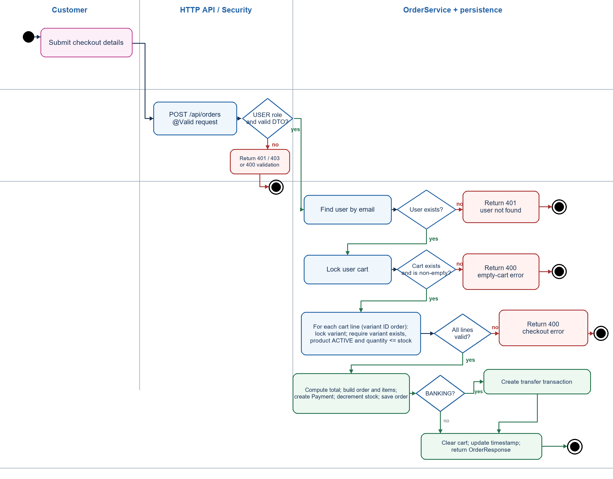
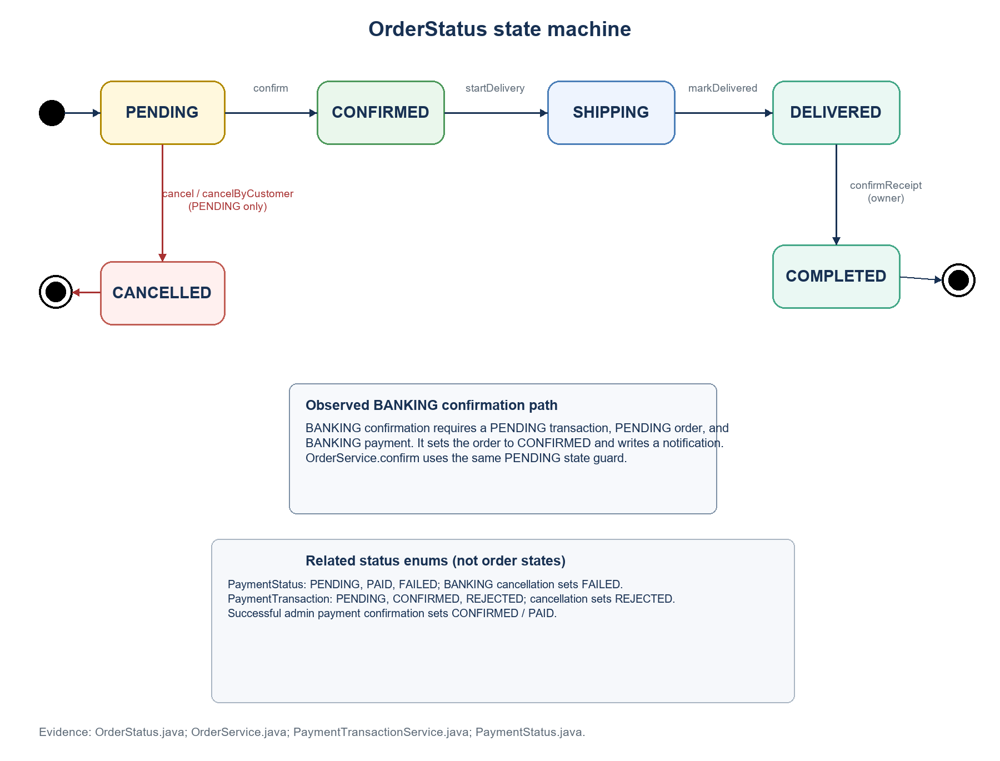
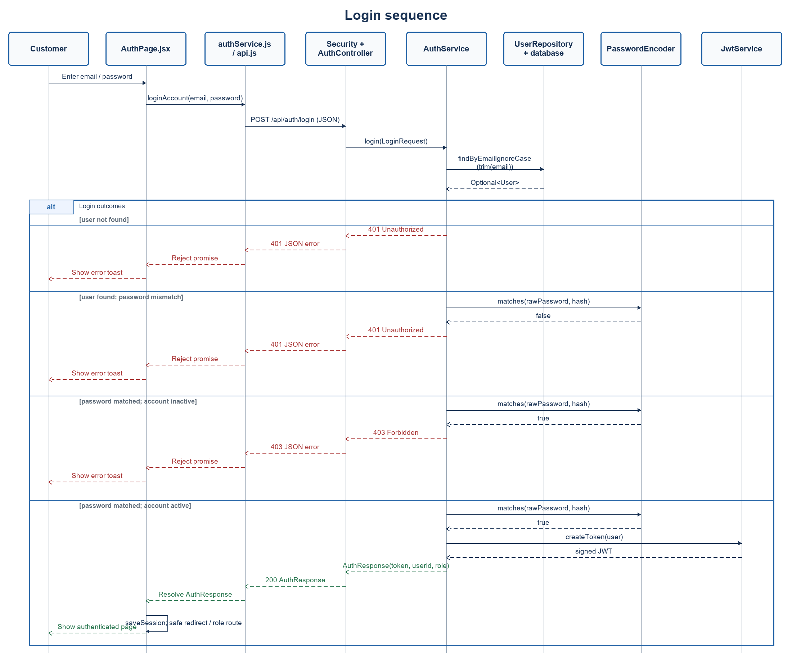

# 02 Thiết kế chi tiết

## Quy ước đọc tài liệu

**Đã xác minh trong mã** là hành vi thể hiện trực tiếp trong source. **Suy ra từ mã** là hệ quả của nhánh, transaction hoặc cấu hình và cần được giữ như giả thuyết kiểm thử đến khi test chứng minh. **Chưa xác định** là phần phụ thuộc môi trường hoặc hợp đồng không có trong repo. Tất cả endpoint và DTO được liệt kê ở `04-api-design.md`; tài liệu này tập trung vào trách nhiệm, kiểu đầu vào/đầu ra, nhánh nghiệp vụ và phụ thuộc.

Các đường dẫn backend được tính từ thư mục `shopee/`; đường dẫn frontend bắt đầu bằng `frontend/`.

## 1. Khởi động và cấu hình

### ShopeeApplication

`ShopeeApplication.main(String[] args): void` khởi động Spring Boot. Component scan bắt đầu từ package `com.project_shopping.shopee`.

### AdminBootstrap

`AdminBootstrap.run(ApplicationArguments): void` chạy trong transaction. Nếu cả admin email và password đều blank thì thoát; nếu chỉ thiếu một thì ném `IllegalStateException`; email được trim/lowercase. Nếu tìm thấy email: chỉ chấp nhận tài khoản có role ADMIN và bật lại tài khoản đó nếu inactive. Nếu chưa có: tạo user tên “Quản trị viên”, role ADMIN, password đã mã hóa. Phụ thuộc: `UserRepository`, `PasswordEncoder`, hai thuộc tính `app.bootstrap-admin.*`.

### BankDataInitializer

`run(String... args): void` tạo tài khoản ngân hàng mẫu khi `BankAccountRepository.count() == 0`; không thay đổi danh sách nếu đã có record. Source hiện có giá trị mẫu cứng trong initializer. Phụ thuộc repository.

### DemoDataSeeder

`run(ApplicationArguments): void` thoát khi `app.bootstrap.demo-data.enabled=false`; nếu bật, seed tối đa 20 tài khoản demo, các danh mục/sản phẩm và biến thể còn thiếu, giỏ và đơn cho user mẫu chưa có. Các helper kiểm tra email/role, chuẩn hóa tên, giữ nguyên category/product đã có, bỏ sản phẩm thuộc category inactive, tạo size S/M/L hoặc Free size cho phụ kiện, hai màu, stock ban đầu 15. Đơn demo dùng COD và status/timestamps dựng sẵn, trừ một tồn kho và tạo notification.

Đây là ghi đè trạng thái dữ liệu lúc khởi động theo cách bổ sung chứ không reset. Cấu hình mặc định trong properties bật seed và mật khẩu demo cục bộ là giá trị yếu; tài liệu setup khuyến nghị tắt seeding sau lần seed môi trường live. Thứ tự chạy giữa các runner không được khai báo `@Order`, vì vậy không nên giả định thứ tự khởi tạo trong test.

**Nguồn:** `config/AdminBootstrap.java`, `config/BankDataInitializer.java`, `config/DemoDataSeeder.java`, `application.properties`, `src/BACKEND_SETUP.md`.

## 2. Bảo mật và tài khoản

### SecurityConfig

- `passwordEncoder(): PasswordEncoder` tạo `BCryptPasswordEncoder`.
- `authenticationManager(AuthenticationConfiguration): AuthenticationManager` trả manager do Spring cấu hình.
- `securityFilterChain(HttpSecurity, JwtAuthenticationFilter, ObjectMapper): SecurityFilterChain` bật CORS, tắt CSRF, dùng session STATELESS, cấu hình JSON 401/403 và gắn JWT filter trước username/password filter.
- Quyền xác minh được: OPTIONS public; register/login public; `/api/auth/me` yêu cầu USER hoặc ADMIN; GET product/catalog/public bank cho phép anonymous; `/api/admin/**` yêu cầu ADMIN; cart/orders/notifications/wishlist yêu cầu USER; phần còn lại cần authenticated.

### JwtService và JwtAuthenticationFilter

- `JwtService(String secret, long expirationMs)` kiểm secret tối thiểu 32 byte sau khi resolve; expiration phải lớn hơn 0. Secret rỗng tạo random 32 byte, nên token mất hiệu lực khi process restart.
- `createToken(User): String` ký subject=email, claim role, issued-at và expiration.
- `extractSubject(String): String` kiểm chữ ký và parse signed claims; JWT exception có thể được filter xử lý.
- `shouldNotFilter(HttpServletRequest): boolean` bỏ qua register/login, OPTIONS, GET product/catalog và GET active-bank.
- `doFilterInternal(...)` lấy token `Bearer `; nếu có token và chưa có Authentication thì gọi `authenticateUser`, rồi tiếp tục chain.
- `authenticateUser(String, request): void` đọc subject, tra user ignore-case, chỉ xác thực user active; JWT lỗi/argument error xóa security context.
- `setAuthentication(User, request): void` dựng UserDetails với `roles(user.getRole().name())`. Role claim trong token không làm nguồn quyền; role lấy từ bản ghi user hiện tại.

Phụ thuộc cần giả lập cho unit: `UserRepository`, `JwtService`, request/response/filter chain. Security matchers và 401/403 nên kiểm bằng MockMvc/security integration bổ sung vì kiểm service đơn thuần không bao phủ filter chain.

### AuthService

| Phương thức | Đầu vào → đầu ra | Trách nhiệm, nhánh và lỗi | Phụ thuộc |
|---|---|---|---|
| `register(RegisterRequest): UserResponse` | DTO → profile DTO | trim tên, trim/lowercase email; duplicate ignore-case → 409; password encode; role luôn USER; lưu user | UserRepository, PasswordEncoder |
| `login(LoginRequest): AuthResponse` | DTO → token, userId, role | tìm theo email ignore-case sau trim; thiếu hoặc sai password → 401 cùng thông báo; inactive sau khi password đúng → 403; thành công tạo JWT | UserRepository, PasswordEncoder, JwtService |
| `profile(String email): UserResponse` | email → profile | thiếu user → 401; map id/name/email/role/phone, không trả password | UserRepository |
| `updateProfile(String, ProfileUpdateRequest): UserResponse` | email + DTO → profile | thiếu user → 401; cập nhật trim fullName; phone null giữ null, nếu có thì trim; email/role không đổi | UserRepository |

**Nguồn:** `service/AuthService.java`, `security/JwtService.java`, `security/JwtAuthenticationFilter.java`, `config/SecurityConfig.java`.

## 3. Danh mục, sản phẩm và biến thể

### ProductService

- `categories(): List<String>` trả tên category có product ACTIVE theo query repository.
- `search(keyword, category, size, color, minPrice, maxPrice, inStock, page, pageSize, sortKey): ProductPageResponse` kiểm `page` 0–10,000, `pageSize` 1–100; min/max không âm và min ≤ max; chấp nhận sort `newest`, `price_asc`, `price_desc`, `name_asc`, `name_desc` (không phân biệt hoa/thường cho sort); còn lại 400. Mỗi sort dùng `id DESC` làm tie-breaker để thứ tự trang ổn định. Dựng `ProductSpecifications.catalog`, gọi `findAll(spec, PageRequest)` và map page. Query trang nạp sẵn category; `hibernate.default_batch_fetch_size=50` gom tải collection variants theo lô.
- `filterOptions(): ProductFilterOptions` ghép categories, sizes, colors, min/max giá từ các query riêng; size/color và price range chỉ xét biến thể còn hàng, category active, product ACTIVE theo query.
- `related(Long id, int limit): List<ProductResponse>` chỉ bắt đầu từ product ACTIVE thuộc category ACTIVE; limit 1–20; lấy product ACTIVE khác cùng category, mới nhất trước, cắt limit. Không yêu cầu product liên quan còn tồn.
- `getActive(Long id): ProductResponse` chỉ trả product ACTIVE có category ACTIVE; nếu không tìm thấy → 404.
- `listAll(): List<ProductResponse>` admin list theo createdAt giảm dần.
- `create(ProductRequest): ProductResponse` trim tên, bắt buộc category ACTIVE; trạng thái request null giữ default ACTIVE; lưu rồi map.
- `update(Long, ProductRequest): ProductResponse` product không có → 404; thay tên/mô tả/giá/ảnh/category; category phải ACTIVE; status null giữ status hiện tại.
- `deactivate(Long): void` set INACTIVE; không xóa record.
- `addVariant(productId, VariantRequest): VariantResponse` cần product tồn tại, trim size/color, tạo variant; database unique `(product_id,size,color)` bảo vệ trùng.
- `updateVariant(productId, variantId, request): VariantResponse` khóa variant; không có hoặc không thuộc product id → 404; trim size/color và cập nhật tồn/giá.
- `deleteVariant(productId, variantId): void` kiểm tồn tại và đúng product; delete+flush; chỉ `DataIntegrityViolationException` được đổi thành 409 do ràng buộc dữ liệu. Lỗi khác tiếp tục được xử lý như lỗi hệ thống.
- `toResponse`/`toVariant` map entity sang DTO; product response bao gồm variants và category.

Phụ thuộc: ProductRepository (Specification, entity graph, filter options), VariantRepository (lock/unique lookup), CategoryService (yêu cầu category ACTIVE). Giá `Product.price` dùng filter/catalog; giá `ProductVariant.price` dùng giỏ/checkout. Không thấy validator bắt hai giá bằng nhau.

### ProductSpecifications

`catalog(...): Specification<Product>` luôn thêm điều kiện Product ACTIVE và Category ACTIVE, rồi nối điều kiện keyword/category/price/variant bằng AND. Keyword rỗng bỏ qua; keyword so LIKE trên tên, mô tả và tên category sau lower-case, ký tự `\\`, `%` và `_` được escape theo thứ tự. Chuẩn hóa hoa/thường dùng `Locale.ROOT`. Category/size/color trim và so không phân biệt hoa thường. Giá lọc đóng hai biên trên `Product.price`.

Variant conditions cùng match một biến thể trong EXISTS query. `inStock=true` yêu cầu stock > 0; `inStock=false` cùng size/color yêu cầu variant khớp có stock = 0; chỉ `inStock=false` yêu cầu không tồn tại variant stock dương (bao gồm product không có variant). Đây là hành vi suy ra trực tiếp từ predicate.

### CategoryService

- `listAdmin(): List<CategoryResponse>` query projection có số product.
- `create(CategoryRequest)` trim name; tên trùng ignore-case → 409; mô tả blank/null thành null, còn lại trim; active null mặc định true.
- `update(id, request)` thiếu → 404; tên trùng với category khác → 409; cập nhật name/description; active null giữ giá trị cũ; productCount được query lại.
- `delete(id)` thiếu → 404; có bất kỳ product reference → 409; nếu không thì delete.
- `requireActive(id): Category` thiếu hoặc inactive → 400; được gọi khi tạo/chỉnh product.

### Validation request liên quan

`ProductRequest`: name not blank ≤180, categoryId >0, price ≥0.01, tối đa 10 chữ số nguyên/2 chữ số thập phân, giá phải là số nguyên VND; `199000.00` được chấp nhận nhưng `199000.50` bị từ chối. `imageUrl` ≤1000; description không có giới hạn DTO; status nullable. `VariantRequest`: size not blank ≤40, color not blank ≤60, stock ≥0; giá có cùng precision và ràng buộc số nguyên VND. `CategoryRequest`: name not blank ≤80, description ≤500, active nullable. `@WholeVndAmount` chỉ bác phần giá trị lẻ thực sự sau khi bỏ các số 0 cuối, phù hợp với checkout BANKING chuyển tổng tiền sang số nguyên chính xác.

**Nguồn:** `service/ProductService.java`, `repository/ProductSpecifications.java`, `repository/ProductRepository.java`, `service/CategoryService.java`, `dto/ApiDtos.java`.

## 4. Giỏ hàng, checkout và trạng thái đơn

### CartService

- `get(email): CartResponse`: thiếu tài khoản → 401; không có cart → response `id=null`, `items=[]`, total 0; có cart map line, subtotal=`variant.price × quantity`, total là tổng line.
- `add(email, CartItemRequest): CartResponse`: khóa user; tìm/khởi tạo cart; khóa variant; variant thiếu → 404; product inactive → 400; nếu dòng variant đã có thì cộng quantity, nếu chưa có thì thêm; tổng mới vượt stock → 400; cập nhật `updatedAt` và lưu.
- `update(email, itemId, CartQuantityRequest)`: khóa user/cart; dòng không thuộc cart → 404; khóa variant; product inactive hoặc quantity vượt stock → 400; gán quantity và cập nhật thời gian.
- `delete(email, itemId): void`: chỉ xóa dòng thuộc cart của user; cart/item thiếu → 404.

Phụ thuộc: `UserRepository`, `CartRepository` và `VariantRepository`; lock bằng `PESSIMISTIC_WRITE`. DTO đảm bảo quantity/variantId >0 trước khi vào service.

### OrderService

- `checkout(email, CheckoutRequest): OrderResponse`: yêu cầu user; cart thiếu/rỗng → 400. Sắp các variant theo id, khóa từng variant; kiểm variant tồn tại, product ACTIVE và quantity không vượt stock. Tính total từ giá biến thể đang khóa; total phải dương và không vượt `999999999999.99`, giới hạn `DECIMAL(14,2)` dùng cho order/subtotal/payment; địa chỉ/phone trim; tạo order mặc định PENDING; tạo OrderItem snapshot tên/size/color và unit price; trừ tồn; tạo Payment; nếu BANKING tạo PaymentTransaction; xóa cart lines, cập nhật thời gian. `@Transactional` gom các ghi; lỗi giữa chừng phải rollback theo transaction manager.
- `myOrders(email)` trả đơn của user mới nhất trước; `myOrder(email,id)` query cả id và user id, không có/không thuộc user → 404.
- `allOrders()` / `adminOrder(id)` phục vụ admin; detail thiếu → 404.
- `confirm(id)` chỉ PENDING → CONFIRMED, ghi `confirmedAt`, tạo notification; status khác → 409.
- `startDelivery(id)` chỉ CONFIRMED → SHIPPING, ghi `shippingAt`, tạo notification; sai status → 409.
- `markDelivered(id)` chỉ SHIPPING → DELIVERED, ghi `deliveredAt`, tạo notification; sai status → 409.
- `confirmReceipt(email,id)` yêu cầu order owner và DELIVERED; chuyển COMPLETED, ghi `customerConfirmedAt`, tạo notification; order không thuộc user → 404, status sai → 409.
- `cancel(id)` là admin hủy; `cancelByCustomer(email,id)` còn kiểm owner; cả hai chỉ cho PENDING. `cancelPendingOrder` khóa và chuyển các payment transaction PENDING sang REJECTED, hoàn tồn, chuyển order CANCELLED, ghi `cancelledAt`, tạo notification; riêng payment BANKING chuyển PENDING sang FAILED.
- `restoreInventory(order)` khóa variant theo id tăng dần; variant mất → 409; cộng quantity bằng `Math.addExact` (overflow ném ArithmeticException); tổng hợp lệ thì tồn tăng.
- `timestampAfter(previous)` trả `max(Instant.now(), previous)` nếu previous có giá trị; khi đồng hồ của instance hiện tại chậm hơn, timestamp bằng mốc trước thay vì từ chối chuyển trạng thái.
- `lockOrder(id)` lock rồi query detail graph; thiếu → 404. `requireOwner`, `requireStatus` là guard private.
- `toResponse(order)` map snapshots; nếu snapshot null dùng giá trị product/variant hiện tại. Với payment BANKING, tìm memo theo order id; không có transaction thì memo null.

State flow được implement chính thức: PENDING → CONFIRMED → SHIPPING → DELIVERED → COMPLETED, hoặc PENDING → CANCELLED. Hai đường xác nhận (OrderService và xác nhận chuyển khoản) đều yêu cầu order PENDING; đường BANKING còn yêu cầu transaction PENDING và Payment có phương thức BANKING.

**Nguồn:** `service/CartService.java`, `service/OrderService.java`, `model/OrderItem.java`, `repository/CartRepository.java`, `repository/VariantRepository.java`, `repository/OrderRepository.java`.

## 5. Thanh toán và tài khoản ngân hàng

### PaymentTransactionService

- `createTransactionForOrder(CustomerOrder): PaymentTransaction`: lấy tên item đầu hoặc fallback “AO”; ưu tiên product name snapshot; bỏ dấu/ký tự không chữ-số, uppercase theo `Locale.ROOT`; nếu kết quả rỗng dùng “AO”; cắt 12 ký tự; nếu có nhiều item thêm `PLUS`; tạo code SecureRandom 8 ký tự; yêu cầu tổng tiền chuyển khoản là số nguyên VND (nếu có phần lẻ → 400); memo chứa order code, tên rút gọn, code và amount; yêu cầu có bank active mới nhất (không có → 409); lưu transaction PENDING.
- `confirmPaymentByAdmin(Long): PaymentTransactionResponse`: truy vấn order id, khóa order trước rồi khóa transaction; thiếu transaction/order → 404; transaction không PENDING, order không PENDING hoặc payment không phải BANKING → 409. Khi hợp lệ, đặt transaction CONFIRMED, order CONFIRMED và payment PAID; cùng một mốc thời gian không sớm hơn `createdAt` của order/transaction; tạo notification; lưu thay đổi trong transaction.
- `getAllTransactionsForUniver(): List<PaymentTransactionResponse>` trả toàn bộ mới nhất trước.
- `toResponse` map các trường dashboard.

### PaymentMemoUtil

- `stripAccents(String): String`: null/blank → chuỗi rỗng; NFD normalize, bỏ combining marks, đ/Đ thành d/D, bỏ ký tự ngoài ASCII chữ/số, uppercase theo `Locale.ROOT`. Tên chỉ có ký tự ngoài Latin cho kết quả rỗng; service dùng “AO” làm fallback.
- `generateRandomCode(int): String`: sinh đúng số ký tự từ alphabet không chứa I/O/0/1 (`ABCDEFGHJKLMNPQRSTUVWXYZ23456789`) bằng `SecureRandom`; service gọi với độ dài 8. Hàm tiện ích không kiểm tra length dương và không bảo đảm không trùng.

### Bank APIs và initializer

`AdminBankController.saveBankAccount` gọi `BankAccountService.saveActiveAccount`; service mở transaction, khóa các dòng tài khoản hiện có, tắt active trên các dòng đó và lưu tài khoản mới đang active. Chuẩn hóa bankCode/accountName dùng `Locale.ROOT`. DTO chặn độ dài vượt cột (20/100/50/120/20). Query lấy active account có id lớn nhất. Mapping entity không có unique constraint bảo đảm chỉ một active row; tính cạnh tranh lúc bảng trống phụ thuộc lock/isolation của database và cần kiểm tra MySQL thật. `BankDataInitializer` tạo row demo khi bảng rỗng trong cấu hình dev.

**Chưa xác định:** Univer không xuất hiện dưới dạng integration/API client trong source/dependencies; việc đồng bộ sheet ngoài ứng dụng chưa được mô tả.

**Nguồn:** `service/PaymentTransactionService.java`, `util/PaymentMemoUtil.java`, `controller/AdminBankController.java`, `controller/PublicBankController.java`, `model/BankAccount.java`, `model/PaymentTransaction.java`.

## 6. Reviews, wishlist và notifications

### ReviewService

- `list(productId): List<ReviewResponse>` product id không tồn tại → 404; nếu tồn tại, kể cả product inactive, trả reviews mới nhất trước.
- `create(email, productId, ReviewRequest): ReviewResponse` user thiếu → 401; role khác USER → 403; product thiếu → 404; không có order COMPLETED chứa product → 403; review đã có theo `(user,product)` → 409; nếu qua guard, lưu review.
- Rating DTO `@Positive @Max(5)` nên khoảng hợp lệ là 1–5; comment nullable tối đa 1000.

### WishlistService

- `get(email)` chỉ liệt kê product ACTIVE trong category ACTIVE, mới tạo trước, kèm variants.
- `add(email, productId)` nếu row đã tồn tại thì idempotent và trả danh sách hiện tại; nếu chưa có thì user không tìm thấy → 404, product không ACTIVE/category inactive/không tồn tại → 404, nếu hợp lệ lưu rồi trả danh sách.
- `remove(email, productId): void` xóa nếu tìm thấy; nếu không có thì no-op.

### NotificationService

- `list(email)` resolve user id; không có user → 401; trả notifications mới nhất trước.
- `markRead(email,id)` chỉ tìm notification vừa khớp id và user id; thiếu/không thuộc user → 404; set `read=true`, trả DTO. Gọi lại là vẫn true.

**Nguồn:** `service/ReviewService.java`, `service/WishlistService.java`, `service/NotificationService.java`, repositories tương ứng.

## 7. Quản trị, tổng hợp và lỗi API

### AdminUserService

- `list()` map user theo thời gian tạo giảm dần.
- `setActive(id, active)` thiếu id → 404; target không phải role USER → 403; còn lại set active và trả DTO. Chỉ đổi USER; filter JWT chặn user inactive ở request kế tiếp. Controller không truyền principal vì service chỉ thao tác với tài khoản USER mục tiêu.

### AdminStatisticsService

`dashboard(): AdminStatisticsResponse` ghép nhiều repository query: total/active/inactive products; total inventory mọi variant; low-stock products (tổng stock 1..5, ngưỡng hằng số 5); active products không có variant stock >0; tổng orders, pending/completed/cancelled; số role USER; revenue status COMPLETED; product totals per category; count per status; 10 top-selling products của order COMPLETED theo tổng quantity giảm dần.

Các summary query trả `Object[]` rồi service ép kiểu. Cần test null/empty/number-type boundary với đúng dialect/projection vì H2 và MySQL có thể trả kiểu numeric khác nhau.

### ApiExceptionHandler

`@RestControllerAdvice` ánh xạ `ResponseStatusException` sang status/reason; thiếu query parameter, type mismatch, validation, JSON không đọc được thành 400; data-integrity thành 409; exception còn lại log lỗi và trả 500 thông điệp tổng quát. `localizedStatus(HttpStatus)` map các status 400/401/403/404/409/500; status khác thành “Yêu cầu không thể xử lý”. Validation chỉ lấy lỗi field đầu tiên; helper `fieldLabel`, `translateSizeMessage` tạo nhãn/diễn giải tiếng Việt.

**Nguồn:** `service/AdminUserService.java`, `service/AdminStatisticsService.java`, `repository/ProductRepository.java`, `repository/OrderRepository.java`, `controller/ApiExceptionHandler.java`.

## 8. Frontend và giao diện giữa các module

Source frontend tại `C:\DAAAN\shopee\frontend\src`.

- `main.jsx` khởi tạo React StrictMode, BrowserRouter và App.
- `App.jsx` giữ user/session, số lượng giỏ và toast; khi user là USER tải giỏ; bắt event `shopnest:session-expired`; logout xóa localStorage và về `/`.
- `AppRoutes.jsx` khai báo route khách hàng/admin; `AdminAccess` yêu cầu role ADMIN và `CustomerAccess` yêu cầu USER, người chưa đăng nhập được đưa tới login có redirect. Đây là gate UI; backend vẫn quyết định quyền.
- `api.js`: `getToken/getUser/saveSession/clearSession`, wrapper `api(path, options)` gắn bearer token và JSON content type, xử lý network/abort/204/non-2xx và xóa session khi 401; `money` định dạng VND.
- `services/*Service.js` ánh xạ UI sang API auth, product/review, cart, order, notification, wishlist và admin. Phần này không có test runner/script test trong package.json.
- Các trang stateful: `CatalogPage` xây query params, reset page khi đổi filter, gọi filter options/catalog; `ProductDetailPage` chọn variant, giới hạn UI quantity theo stock, thêm giỏ, load reviews/related và tạo review; `CheckoutPage` gửi checkout; `OrderDetailPage` hủy/xác nhận nhận hàng; `AdminOrdersPage.actionsFor` tạo thao tác theo status; `WishlistContext` đồng bộ ids theo session và toggle API; `AccountPage` tải/cập nhật hồ sơ.

Frontend input checks không thay thế backend DTO validation. Nguồn: `frontend/src/App.jsx`, `AppRoutes.jsx`, `api.js`, `services/*`, `features/*`.

## 9. Giao kèo transaction và phụ thuộc

- `@Transactional` được đặt trên các service mutation chính; unit tests có thể mock repositories để kiểm tra thứ tự gọi và kết quả, nhưng không chứng minh rollback/row locks.
- Pessimistic locks xuất hiện tại user/cart/variant/order repository. Nên bổ sung integration test chạy database thật được hỗ trợ để kiểm tra lock contention/concurrent checkout, ngoài inventory unit test.
- Spring Data derived queries và JPQL repository là giao diện đến persistence; trong unit test có thể mock. Query semantics, `EntityGraph`, unique constraints, migration và cascade cần persistence integration test riêng.
- Cần `Clock`/time seam để kiểm thử chính xác timestamp nếu muốn assertion ổn định; hiện service gọi `Instant.now()` trực tiếp.

## 10. Biểu đồ Activity cho checkout

Activity partition tách khách hàng, HTTP API/bảo mật và xử lý checkout/persistence. Các nhánh thể hiện quyền `USER` và `@Valid`, user không tìm thấy (401), giỏ thiếu/rỗng, biến thể thiếu hoặc sản phẩm không ACTIVE/tồn không đủ, phương thức BANKING và kết thúc thành công. `OrderController.checkout` gắn HTTP 201; `OrderService.checkout` chạy trong transaction, khóa giỏ/biến thể và xóa dòng giỏ sau khi tạo đơn. Lỗi cụ thể từ từng guard được thể hiện theo các `ResponseStatusException` trong service.

**Nguồn:** `controller/OrderController.java:24-34`; `config/SecurityConfig.java`; `service/OrderService.java:41-110`; `service/PaymentTransactionService.java:createTransactionForOrder`; `dto/ApiDtos.java:CheckoutRequest`.

PlantUML source: [`activity-checkout.puml`](diagrams/activity-checkout.puml).

## 11. Biểu đồ State Machine cho đơn hàng

Các state `PENDING`, `CONFIRMED`, `SHIPPING`, `DELIVERED`, `COMPLETED`, `CANCELLED` khớp enum `OrderStatus`. `OrderService` guard theo trạng thái trước; hủy chỉ nhận `PENDING`, các chuyển tiếp giao hàng cần trạng thái tương ứng và xác nhận nhận hàng kiểm tra chủ đơn. Đường xác nhận BANKING cũng kiểm tra order PENDING, transaction PENDING và payment BANKING trước khi xác nhận.

Sơ đồ chính mô tả lifecycle order. `PaymentStatus` và `PaymentTransaction.TransactionStatus` có enum riêng; khi hủy, payment BANKING chuyển `PENDING → FAILED`, transaction `PENDING → REJECTED`; khi admin xác nhận chuyển khoản hợp lệ, transaction thành `CONFIRMED` và payment thành `PAID`.

**Nguồn:** `model/enums/OrderStatus.java`; `model/enums/PaymentStatus.java`; `model/PaymentTransaction.java`; `service/OrderService.java:41,113-206`; `service/PaymentTransactionService.java:76-105`.

PlantUML source: [`state-order-payment.puml`](diagrams/state-order-payment.puml).

## 12. Biểu đồ Sequence cho đăng nhập

Lifeline gom `authService.js` và `api.js` thành HTTP client phía trình duyệt, và gom Spring Security/MVC thành biên API. Combined fragment `alt` ghi riêng: không tìm thấy user → 401; sai mật khẩu → 401; đúng mật khẩu nhưng tài khoản inactive → 403; đúng và active → tạo JWT, trả `AuthResponse`, lưu session và điều hướng theo role/redirect an toàn. Khi có lỗi, API client từ chối promise và `AuthPage` hiển thị toast.

**Nguồn:** `frontend/src/features/auth/AuthPage.jsx`, `frontend/src/services/authService.js`, `frontend/src/api.js` (frontend sibling); `controller/AuthController.java:31-38`; `controller/ApiExceptionHandler.java`; `service/AuthService.java:66-100`; `repository/UserRepository.java`; `security/JwtService.java`.

PlantUML source: [`sequence-login.puml`](diagrams/sequence-login.puml).

### Căn cứ ký hiệu và giới hạn

Các node hình tròn/đích là initial/final, hình thoi là decision/merge, khung `alt` là các operand thay thế, và các mũi tên nét đứt là message return/dependency theo ngữ nghĩa biểu đồ tương ứng. Quy ước được đối chiếu với [OMG UML 2.5.1](https://www.omg.org/spec/UML/2.5.1/PDF) và hướng dẫn chính thức PlantUML về [Activity](https://plantuml.com/en/activity-diagram-beta), [State](https://plantuml.com/en/state-diagram), [Sequence](https://plantuml.com/en/sequence-diagram). Sơ đồ mô tả phần source đã xác minh, không thay thế hợp đồng giao diện cho frontend sibling chưa xác nhận cùng phiên bản.

