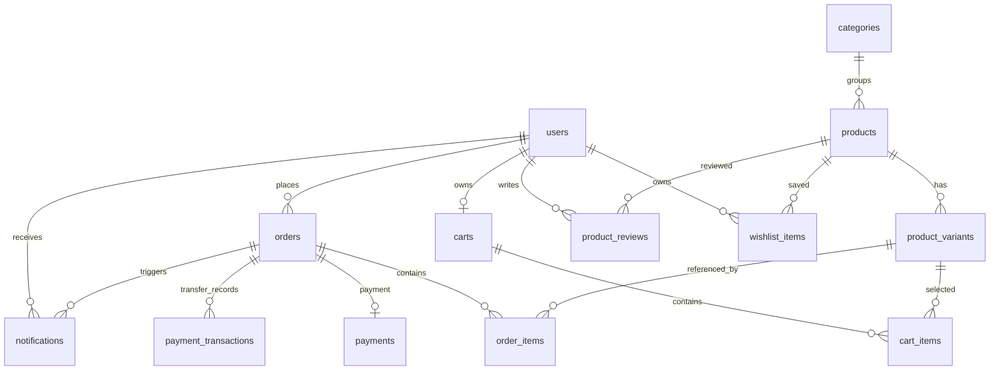

# 03 Thiết kế cơ sở dữ liệu

## Nguồn schema và cách diễn giải

Các đường dẫn backend trong tài liệu này được tính từ thư mục `shopee/`.

Entity JPA trong `src/main/java/com/project_shopping/shopee/model` là mô hình được ứng dụng map. SQL migrations V1–V9 trong `src/main/resources/db/migration` ghi lại các kiểu, khóa, index và thay đổi schema theo lịch sử. Tuy nhiên `src/main/resources/application.properties` hiện cấu hình `spring.flyway.enabled=false` cùng `spring.jpa.hibernate.ddl-auto=update`; vì vậy migrations không chạy theo cấu hình mặc định đã commit. Các bảng/kiểu MySQL dưới đây được xác minh từ SQL migration khi có migration tương ứng; nơi chỉ có mapping JPA, kiểu SQL chính xác là **suy ra theo dialect MySQL**.

`src/BACKEND_SETUP.md` và properties đều ghi Flyway tắt; production database thực tế và migration history chưa thể xác minh. Test profile dùng H2 `MODE=MySQL`, `ddl-auto=create-drop`, Flyway off. Không có file dump/schema môi trường thật.

## ERD

Cardinalities derive from JPA relations and/or SQL unique constraints. `payment_transactions.order_id` is many-to-one in the entity and is not unique; `payments.order_id` is one-to-one/unique. BankAccount has no foreign-key relation in the model. Order lines keep a foreign key to live product variant and also nullable product/size/color snapshots.

## Tables and fields

Type abbreviations: `PK` primary key, `FK` foreign key, `NN` not null, `UQ` unique, `NULL` nullable. `TIMESTAMP(6)` precision is explicit in migration SQL where noted. Auto IDs use `BIGINT AUTO_INCREMENT` in V1.

### users

Nguồn: V1 `users`; entity `User.java`; V7 adds active.

| Trường | Kiểu | Ràng buộc / ghi chú |
|---|---|---|
| id | BIGINT | PK, auto increment |
| full_name | VARCHAR(120) | NN |
| email | VARCHAR(190) | NN, UQ; service canonicalizes register email |
| password_hash | VARCHAR(100) | NN; lưu BCrypt hash |
| role | VARCHAR(20) | NN, enum string USER/ADMIN |
| active | BOOLEAN | NN, default true ở V7/JPA |
| phone | VARCHAR(30) | nullable |
| created_at | TIMESTAMP(6) | NN, không update sau insert trong entity |

### categories

Nguồn: V5 và entity `Category.java`.

| Trường | Kiểu | Ràng buộc / ghi chú |
|---|---|---|
| id | BIGINT | PK, auto increment |
| name | VARCHAR(80) | NN, UQ |
| description | VARCHAR(500) | nullable |
| active | BOOLEAN | NN, default true ở V5/JPA |
| created_at | TIMESTAMP(6) | NN, immutable trong entity |

### products

Nguồn: V1, V2, V5; entity `Product.java`. V2 thêm category dạng text; V5 migrate thành category_id rồi drop cột text cũ.

| Trường | Kiểu | Ràng buộc / ghi chú |
|---|---|---|
| id | BIGINT | PK, auto increment |
| name | VARCHAR(180) | NN |
| category_id | BIGINT | NN, FK → categories.id, index `idx_products_category_id` |
| description | TEXT | nullable |
| price | DECIMAL(12,2) | NN, V1 CHECK price > 0 |
| image_url | VARCHAR(1000) | nullable |
| status | VARCHAR(20) | NN, enum string ACTIVE/INACTIVE |
| created_at | TIMESTAMP(6) | NN, immutable trong entity |

### product_variants

Nguồn: V1; entity `ProductVariant.java`.

| Trường | Kiểu | Ràng buộc / ghi chú |
|---|---|---|
| id | BIGINT | PK, auto increment |
| product_id | BIGINT | NN, FK → products.id |
| size | VARCHAR(40) | NN |
| color | VARCHAR(60) | NN |
| stock_quantity | INT | NN, V1 CHECK >= 0 |
| price | DECIMAL(12,2) | NN, V1 CHECK > 0 |
| (product_id,size,color) | — | UQ `uq_variant_product_size_color`; DB collation quyết định case sensitivity |

### carts và cart_items

Nguồn: V1; entity `Cart.java`, `CartItem.java`.

| Bảng | Trường | Kiểu và ràng buộc |
|---|---|---|
| carts | id | BIGINT PK auto increment |
| carts | user_id | BIGINT NN UQ FK → users.id; một cart mỗi user |
| carts | created_at, updated_at | TIMESTAMP(6) NN |
| cart_items | id | BIGINT PK auto increment |
| cart_items | cart_id | BIGINT NN FK → carts.id ON DELETE CASCADE |
| cart_items | variant_id | BIGINT NN FK → product_variants.id |
| cart_items | quantity | INT NN CHECK > 0 trong V1 |
| cart_items | (cart_id,variant_id) | UQ; một dòng mỗi variant trong cart |

### orders và order_items

Nguồn: V1, V3, V4; entity `CustomerOrder.java`, `OrderItem.java`.

| Bảng | Trường | Kiểu và ràng buộc |
|---|---|---|
| orders | id | BIGINT PK auto increment |
| orders | user_id | BIGINT NN FK → users.id |
| orders | shipping_address | VARCHAR(500) NN |
| orders | phone | VARCHAR(30) NN |
| orders | total_amount | DECIMAL(14,2) NN CHECK > 0 trong V1 |
| orders | status | VARCHAR(20) NN enum string PENDING/CONFIRMED/SHIPPING/DELIVERED/COMPLETED/CANCELLED |
| orders | created_at | TIMESTAMP(6) NN |
| orders | confirmed_at, shipping_at, delivered_at, customer_confirmed_at, cancelled_at | TIMESTAMP(6) nullable; thêm bởi V3 |
| orders | index | `idx_orders_user_created(user_id,created_at)` trong V1 |
| order_items | id | BIGINT PK auto increment |
| order_items | order_id | BIGINT NN FK → orders.id |
| order_items | variant_id | BIGINT NN FK → product_variants.id |
| order_items | quantity | INT NN CHECK > 0 trong V1 |
| order_items | unit_price | DECIMAL(12,2) NN |
| order_items | sub_total | DECIMAL(14,2) NN |
| order_items | product_name_snapshot | VARCHAR(180) nullable; V4 backfill từ product name |
| order_items | size_snapshot | VARCHAR(40) nullable; V4 backfill từ variant size |
| order_items | color_snapshot | VARCHAR(60) nullable; V4 backfill từ variant color |

V1 không khai báo `ON DELETE CASCADE` cho order item. Entity dùng cascade từ order xuống items, nhưng FK vật lý và chính sách xóa vẫn phụ thuộc DDL thực tế. Snapshot giữ tên/size/color tại lúc tạo đơn; service response fallback sang dữ liệu hiện hành nếu snapshot null.

### payments

Nguồn: V1; entity `Payment.java`.

| Trường | Kiểu | Ràng buộc / ghi chú |
|---|---|---|
| id | BIGINT | PK auto increment |
| order_id | BIGINT | NN, UQ, FK → orders.id; một payment mỗi order |
| payment_method | VARCHAR(20) | NN enum string COD/BANKING |
| payment_status | VARCHAR(20) | NN enum string PENDING/PAID/FAILED |
| amount | DECIMAL(14,2) | NN |
| paid_at | TIMESTAMP(6) | nullable |

### notifications

Nguồn: V1; entity `Notification.java`.

| Trường | Kiểu | Ràng buộc / ghi chú |
|---|---|---|
| id | BIGINT | PK auto increment |
| user_id | BIGINT | NN FK → users.id |
| order_id | BIGINT | NN FK → orders.id |
| title | VARCHAR(180) | NN |
| message | VARCHAR(500) | NN |
| type | VARCHAR(30) | NN enum string; hiện chỉ ORDER_STATUS |
| is_read | BOOLEAN | NN default false |
| created_at | TIMESTAMP(6) | NN |
| index | — | `idx_notifications_user_created(user_id,created_at)` V1 |

### product_reviews

Nguồn: V6; entity `ProductReview.java`.

| Trường | Kiểu | Ràng buộc / ghi chú |
|---|---|---|
| id | BIGINT | PK auto increment |
| user_id | BIGINT | NN FK → users.id |
| product_id | BIGINT | NN FK → products.id |
| rating | INT | NN CHECK BETWEEN 1 AND 5 trong V6 |
| comment | VARCHAR(1000) | nullable |
| created_at | TIMESTAMP(6) | NN |
| (user_id,product_id) | — | UQ; mỗi user một review mỗi product |
| index | — | `idx_product_reviews_product_created(product_id,created_at)` V6 |

### wishlist_items

Nguồn: V8; entity `WishlistItem.java`.

| Trường | Kiểu | Ràng buộc / ghi chú |
|---|---|---|
| id | BIGINT | BIGINT PK auto increment |
| user_id | BIGINT | NN FK → users.id |
| product_id | BIGINT | NN FK → products.id |
| created_at | TIMESTAMP | NN default CURRENT_TIMESTAMP |
| (user_id,product_id) | — | UQ `uk_wishlist_user_product` |
| index | — | `idx_wishlist_user_created(user_id,created_at)` |

### bank_accounts và payment_transactions

Hai entity này map bảng `bank_accounts` và `payment_transactions`. Migration V9 bổ sung DDL `CREATE TABLE IF NOT EXISTS` khớp tên/cột/độ dài/precision/quan hệ khai báo ở entity, nhưng Flyway vẫn tắt trong cấu hình mặc định và migration chưa được kiểm thử trên MySQL deployment. `transfer_memo` không có UNIQUE vì entity không khai báo và dữ liệu thật chưa được kiểm kê.

| Bảng | Trường và kiểu Java/JPA | Ràng buộc đã khai báo |
|---|---|---|
| bank_accounts | id Long; bank_code String(20); bank_name String(100); account_no String(50); account_name String(120); qr_template String(20); active boolean; created_at Instant | PK; bốn chuỗi bank code/name/account no/name NN; active NN; qr_template nullable ở mapping, constructor default “compact”; không thấy UQ/FK |
| payment_transactions | id Long; order_id CustomerOrder; order_code String(50); product_sample_name String(100); random_code String(20); transfer_memo String(100); amount BigDecimal(14,2); bank_account_no String(50); status String(30); univer_row_id String(50); created_at/confirmed_at Instant | PK; order FK NN (ManyToOne, không unique); order_code/random_code/transfer_memo/amount/status/created_at NN; các trường khác nullable; enum PENDING/CONFIRMED/REJECTED |

## Ràng buộc có ý nghĩa nghiệp vụ

- Email duy nhất ở entity/schema; service trước tiên kiểm tra ignore-case, trong race vẫn có thể gặp unique violation.
- Một cart/user, một cart-item/variant, một payment/order, một review/user-product và một wishlist/user-product.
- Stock không âm và quantity trên cart/order item dương trong V1 DDL; request DTO còn kiểm tra quantity và variantId positive, variant stock nonnegative.
- Order total, product/variant price có check dương trong V1; API DTO giới hạn giá tối thiểu 0.01 và `@Digits(integer=10,fraction=2)` theo DECIMAL(12,2). Validator API `@WholeVndAmount` cho phép dạng biểu diễn có `.00` nhưng từ chối phần lẻ khác 0, vì luồng BANKING yêu cầu VND nguyên; đây là kiểm tra request, không phải CHECK constraint mới trong DB. `OrderService.checkout` chặn tổng vượt tối đa `999999999999.99` theo các cột DECIMAL(14,2) trước khi ghi đơn/trừ kho.
- Product phụ thuộc category qua FK không nullable; nghiệp vụ chỉ cho tạo/cập nhật vào category active.
- Order item giữ FK đến variant nên variant có thể không xóa được khi được dùng trong giỏ/đơn; service đổi `DataIntegrityViolationException` khi delete sang 409.
- PaymentTransaction status enum có REJECTED; hủy order chuyển transaction PENDING sang REJECTED.
- Hủy order có Payment BANKING chuyển `Payment.paymentStatus` từ PENDING sang FAILED; xác nhận chuyển khoản hợp lệ chuyển sang PAID.
- Không có ràng buộc database thể hiện order status transition, quyền sở hữu order, user role, category active hoặc điều kiện đã mua hàng; đó là guard trong service/security.

## Lịch sử migration và chênh lệch hiện hành

| Migration | Thay đổi ghi trong file | Trạng thái mặc định |
|---|---|---|
| V1 | Tạo users, products, product_variants, carts, cart_items, orders, order_items, payments, notifications và index/check/FK | Không chạy tự động khi `spring.flyway.enabled=false` |
| V2 | Thêm category dạng text vào products | Bị V5 chuẩn hóa/drop |
| V3 | Thêm các mốc giao hàng/trạng thái order | Chỉ chạy nếu bật Flyway |
| V4 | Thêm snapshot tên/size/color và backfill order_items | Chỉ chạy nếu bật Flyway |
| V5 | Tạo categories, chuyển product.category sang category_id FK, drop text category | Chỉ chạy nếu bật Flyway |
| V6 | Tạo product_reviews, rating check/unique/index | Chỉ chạy nếu bật Flyway |
| V7 | Thêm users.active default true | Chỉ chạy nếu bật Flyway |
| V8 | Tạo wishlist_items và unique/index | Chỉ chạy nếu bật Flyway |
| V9 | Tạo `bank_accounts`, `payment_transactions` nếu chưa tồn tại; FK giao dịch tới orders và index theo order | Chỉ chạy nếu bật Flyway |

**Chưa xác định:** trạng thái migration hiện tại của DB deployment, liệu hai bảng thanh toán đã được Hibernate tạo và có khớp V9 không, ràng buộc/index được sinh bởi Hibernate update, dữ liệu cũ và liệu production có profile/property override bật Flyway hoặc tắt seeder không. V9 chỉ chuẩn bị migration cho schema; chưa bật migration, `ddl-auto` vẫn là `update`. Không thêm unique index cho `transfer_memo` khi chưa đối chiếu schema/dữ liệu production.

